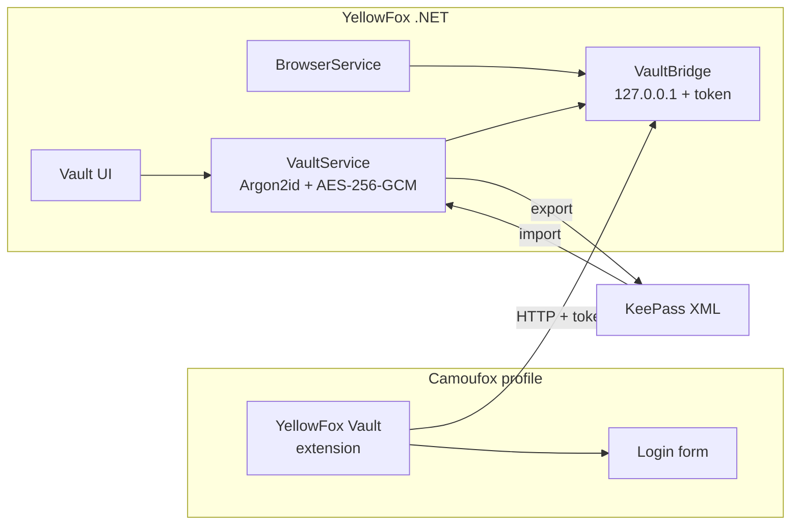

# Менеджер паролей в YellowFox

> [!SUMMARY] Вердикт
> Идея хорошая, но в предложенном виде её надо поправить в трёх местах. Нужно **одно общее шифрованное хранилище**, а не копия базы внутри каждого профиля; **явная привязка записи к профилям**, а не только совпадение по URL; **своё тонкое расширение** с мостом к YellowFox, потому что KeePassXC-Browser не умеет изолировать профили. KeePass при этом остаётся форматом импорта/экспорта, а не рантаймом.

## 1. Что на самом деле болит

Сейчас пароли лежат в KeePass, а профилей много, и у одного и того же сайта в разных профилях разные аккаунты. Главная боль — не «ввести пароль», а **понять, какая запись относится к этому профилю**. Автозаполнение — вторая очередь.

Отсюда приоритет: сначала модель «запись ↔ профиль» и быстрый просмотр/копирование, потом расширение и автозаполнение. Если сделать наоборот, получится красивый автозаполнитель, который подставляет не тот аккаунт.

## 2. Разбор идеи по пунктам

| Предложение | Оценка | Что делать вместо этого |
|---|---|---|
| База KeePass хранится внутри профиля | ❌ | Одно хранилище в `data/vault/`. Профиль получает только отфильтрованный доступ |
| Один master-пароль на все базы | ✅, но | Одно хранилище = один пароль. Несколько разных баз с одним паролем — плохая идея |
| База разблокируется при старте профиля | ⚠️ | Разблокировка один раз за сессию приложения + автоблокировка. Разблокировка «на каждый профиль» с общим хранилищем ничего не даёт |
| Расширение типа KeePassXC-Browser | ✅ | Своё расширение, потому что готовое не знает про профили |
| Пароли вводятся сразу автоматически | ⚠️ | По хоткею/клику по умолчанию. Автоввод на загрузке — опция для конкретного сайта |

### 2.1 Почему копия базы в профиле — плохо

- `profiles/<id>/` — это user-data каталог Camoufox. Его **целиком кладут в backup-zip** (`ProfileBackupService`), копируют при диагностике и удаляют при очистке профиля. База с паролями уедет в бэкап и в чужие руки.
- Профилей десятки. Копии начнут расходиться: в одном профиле пароль обновили, в другом остался старый.
- Клонирование создаёт новый каталог без базы — клон останется без паролей; а ручное копирование каталога, наоборот, утащит их.
- Обновить один пароль во всех копиях невозможно без отдельной синхронизации.

Правильно: **один файл хранилища вне профилей**, а связь с профилем — это ссылка (ID профиля) в записи.

### 2.2 Почему «один master на все базы» — не то, что нужно

Один пароль на несколько независимых баз означает, что компрометация одной открывает все. Если делать несколько хранилищ (например, личное и рабочее), у каждого должен быть свой пароль или key file.

Для задачи пользователя достаточно **одного хранилища на все профили**. Это одновременно и «один master-пароль», и отсутствие дублирования.

### 2.3 Почему KeePassXC-Browser не решает задачу

KeePassXC-Browser — зрелое решение, но оно принципиально не умеет того, что нужно:

- Он матчит записи **по URL** и показывает все подходящие записи из открытой базы. Все профили, подключённые к одному KeePassXC, видят один и тот же набор.
- Групповые ограничения browser integration в KeePassXC действуют **глобально на инстанс**, а не на конкретный профиль браузера.
- Нужен установленный KeePassXC и native messaging host; master-пароль запрашивает KeePassXC, а не YellowFox.
- «Профиль автоматически подключается к своей части базы» не выражается его моделью данных.

Итог: как ручной fallback — годится, как целевое решение — нет.

## 3. Готовые решения: что рассматривали

| Вариант | Изоляция профилей | Автозаполнение | Объём кода | Вердикт |
|---|---|---|---|---|
| KeePassXC + KeePassXC-Browser | ❌ | ✅ | минимум | Не подходит: все профили видят все записи по URL |
| KeePass 2 + Kee (KeePassRPC) | ❌ | ✅ | минимум | То же + вопрос совместимости с текущим Camoufox |
| Bitwarden / Vaultwarden + расширение | ❌ | ✅ | минимум + сервер | Хуже: облако/сервер, та же проблема URL |
| Встроенный менеджер Firefox (`logins.json`) | ✅ | ✅ | средне | Изоляция есть, но нет общей картины и master-пароля на всё; доступ программно — через NSS |
| Автозаполнение через Playwright/CDP | ✅ | ⚠️ | средне | Плохо: браузер должен жить под автоматизацией, инъекции заметны, ломается при ручной работе |
| **Своё хранилище + своё расширение** | ✅ | ✅ | высокий | **Рекомендуется** для целевого сценария |

> [!IMPORTANT] Про «велосипед»
> Писать свой **формат шифрования** — велосипед. Использовать стандартные примитивы (Argon2id + AES-256-GCM), не изобретать криптографию и не парсить KDBX в v1 — нормально. Основная работа здесь не крипто, а модель профилей, UX и мост к браузеру.

## 4. Рекомендуемая архитектура



Компоненты:

1. **VaultService** — открывает/расшифровывает файл, держит расшифрованные данные в памяти, делает CRUD, блокируется, пишет атомарно.
2. **Vault UI** — отдельный раздел в сайдбаре + фильтр «пароли этого профиля» из контекстного меню профиля.
3. **VaultBridge** — локальный HTTP-сервер на `127.0.0.1`, который отдаёт расширению **только записи текущего профиля**.
4. **Расширение** `yellowfox-vault` — content script ищет поля логина/пароля и заполняет их по клику/хоткею.
5. **Импорт/экспорт** — KeePass XML (2.x) в v1. KDBX напрямую не читаем; CSV — позже, если понадобится.

## 5. Модель данных и правила

### 5.1 Файл хранилища

`data/vault/yellowfox.vault` — JSON-конверт:

```json
{
  "version": 1,
  "kdf": { "algo": "argon2id", "salt": "base64", "memoryKb": 65536, "iterations": 3, "parallelism": 1 },
  "cipher": { "algo": "aes-256-gcm", "nonce": "base64" },
  "ciphertext": "base64"
}
```

Расшифрованный payload:

```json
{
  "version": 1,
  "entries": [
    {
      "id": "guid",
      "title": "Facebook — ферма 1",
      "username": "user@example.com",
      "password": "...",
      "urls": ["https://facebook.com"],
      "notes": "",
      "totpSecret": null,
      "profileIds": ["profile-guid"],
      "allProfiles": false,
      "createdAt": "2026-11-25T10:00:00Z",
      "updatedAt": "2026-11-25T10:00:00Z"
    }
  ]
}
```

Почему один файл, а не SQLite: меньше поверхности утечки (нет WAL/временных страниц), проще бэкап и атомарная запись, проще аудит формата. Записей будут тысячи, а не миллионы — файла достаточно.

### 5.2 Привязка к профилям

- `allProfiles = true` — запись доступна всем профилям (общий аккаунт).
- `profileIds` — точный список профилей.
- **Пусто и `allProfiles = false` — запись не предлагается ни одному профилю.** Это осознанное отличие от расширений/закладок, где «без тега» = «всем». Для паролей default должен быть deny.

Почему ID профилей, а не теги: в антидетекте типичный случай — «один профиль = один аккаунт». Тег на каждый профиль превратится в сотни тегов. Теги можно добавить позже как массовое назначение, но хранить связь лучше явно.

При удалении профиля его ID вычищается из записей. Запись без профилей остаётся только в общем хранилище и никуда не подставляется.

### 5.3 Сопоставление по URL

- Нормализация: нижний регистр, отбросить `www.`, сравнивать host; схема, порт и путь по умолчанию игнорируются.
- Совпадение: точный host или поддомен (`login.example.com` → `example.com`).
- Никакого fuzzy-поиска по заголовку.
- Если для профиля подходит несколько записей — показывать список, не выбирать молча.
- Если одна — хоткей заполняет её; автоввод на загрузке только по явному включению для сайта.

### 5.4 Импорт из KeePass

KeePass 2 умеет `File → Export → KeePass XML (2.x)`. Это plaintext-файл, его надо удалить после импорта.

Что маппим:

- `Title`, `UserName`, `Password`, `URL`, `Notes`;
- несколько URL — в `urls`;
- `Tags` и кастомное поле `YF Profiles` — для привязки;
- если группа KeePass совпадает с именем профиля — предложить автопривязку (с предпросмотром и списком несопоставленных);
- TOTP (`otp` / `TOTP Seed`) — в `totpSecret`, но использовать начнём позже.

Дубликаты: одинаковые `title + username + url` пропускаются с отчётом. Импорт — в память, без временных файлов. XML парсить с `DtdProcessing = Prohibit`.

Экспорт: KeePass XML с группами по привязке (`Shared` + по имени профиля) — чтобы можно было открыть в KeePass и сделать обратный импорт.

## 6. Master-пароль и сессия

- При первом запуске — создание хранилища: мастер-пароль + подтверждение + предупреждение, что восстановления нет.
- При следующих запусках — запрос пароля при старте YellowFox (как просил пользователь).
- KDF: Argon2id, 64 MiB, 3 итерации, 1 поток (параметры калибруются при создании, ~0.5–1 с, и хранятся в файле).
- Шифрование: AES-256-GCM, случайный nonce на каждое сохранение, AAD = заголовок конверта. Неверный пароль = ошибка аутентификации GCM, отдельный verifier не нужен.
- Автоблокировка: по бездействию (15 минут) и при выходе из приложения. Кнопка «Заблокировать» — в UI.
- Смена пароля — перешифровка с новой солью.
- Файл хранилища — права `0600` на Unix и ACL текущего пользователя на Windows. `data/vault/` **не входит** в бэкап профиля, поэтому в инструкции по бэкапу его нужно указать отдельно.
- Секреты не логируются, не попадают в `YellowFox.Cli`, не уходят в телеметрию. Копирование в буфер — с автоочисткой через 30 секунд, если в буфере всё ещё наш секрет.
- Память: ключ держим в `byte[]` и обнуляем при блокировке. Полностью «затереть» строки в .NET нельзя — это ограничение признаём, а не изображаем идеальную защиту.

> [!WARNING] Восстановления нет
> Забытый мастер-пароль = потерянное хранилище. Поэтому: обязательный бэкап файла и понятная инструкция. Опциональный key file можно добавить позже, но не в v1.

## 7. Мост и расширение

### 7.1 Как расширение узнаёт, что оно в этом профиле

Не хранить токен в файлах профиля и не вшивать его в XPI. Схема:

1. При старте профиля YellowFox создаёт одноразовый `nonce`, привязанный к профилю, и поднимает/переиспользует bridge на случайном порту. Сессия создаётся даже если хранилище ещё заблокировано — тогда `/v1/match` будет отвечать `423`.
2. Через уже существующее Playwright-подключение открывается служебная вкладка `http://127.0.0.1:<port>/v1/bootstrap?nonce=...`.
3. Content script на loopback-странице забирает `nonce` и передаёт в background расширения.
4. Background меняет `nonce` на токен сессии (`POST /v1/session`), хранит его в памяти и закрывает служебную вкладку.
5. Токен живёт до остановки профиля; при остановке отзывается.

Почему так: токен не лежит на диске, не зависит от UUID расширения и работает одинаково на Windows/macOS/Linux.

### 7.2 API

```text
POST /v1/session            { nonce } -> { token, profileId, profileName }
GET  /v1/match?url=...      Authorization: Bearer <token>
                            -> [{ id, title, username, password, totp? }]
GET  /v1/health             -> { ok, locked }
```

Правила:

- Только `127.0.0.1`, случайный порт, `Cache-Control: no-store`.
- Только эти эндпоинты. Никакого «отдай всё хранилище», экспорта или сохранения в v1.
- Фильтрация **на сервере**: сначала по токену → профиль, потом по `profileIds`/`allProfiles`, потом по URL. Расширение никогда не видит чужие записи.
- Если хранилище заблокировано — `423 Locked`, без fallback на файл.
- Ошибки не содержат секретов; тела запросов не логируются.
- CORS не включаем: веб-страница не должна читать ответы. Расширению с host permission CORS не нужен.

Сервер: Kestrel (`Microsoft.AspNetCore.App` framework reference) — предсказуемо работает на всех трёх ОС, в отличие от `HttpListener` с его URLACL на Windows. Плюс к размеру публикации будет заметный, но на фоне Camoufox это несущественно.

### 7.3 Поведение расширения

- MV2, background + content script, `run_at: document_idle`.
- Работает в isolated world; UI — в shadow DOM, чтобы не ломать вёрстку и не светить классы.
- Ищет видимые `input[type=password]`, рядом — username-поле.
- По клику на иконку/хоткею `Ctrl+Shift+L` запрашивает `/v1/match` и показывает список username'ов; выбранную запись заполняет через native setter + `input`/`change`.
- Не сабмитит форму.
- Multi-step логины: выбранная запись запоминается на вкладку на несколько минут, чтобы заполнить пароль на следующем шаге.
- Сохранение новых паролей из браузера — не в v1.
- `web_accessible_resources` не нужны, page-world хуки не нужны.

### 7.4 Анти-детект

Парольный менеджер — это дополнительная поверхность детекта, и это надо принять осознанно:

- Расширение видно в `about:addons`; наличие `moz-extension://` ресурсов иногда проверяют.
- Заполнение без нажатий клавиш — поведенческий сигнал для антифрода.
- Поэтому: заполнение по действию пользователя, а не на `DOMContentLoaded`; отсутствие page-world инъекций; минимум DOM; **тумблер «менеджер паролей» на профиль** (по умолчанию включён, но для «чистых» профилей выключается).
- Отдельно: вход в один и тот же сайт из десятков профилей — сам по себе сигнал, не связанный с менеджером паролей.

### 7.5 Текущие долги безопасности, которые всплывут

- `yellowfox-passkeys.json` хранит приватные ключи passkey в **plaintext** внутри профиля, и они попадают в бэкапы. Это отдельная задача, но vault делает несогласованность очевидной.
- Пароли прокси лежат в `yellowfox.db` в открытом виде. Тоже отдельная задача; в этот план не тянем.

## 8. Этапы

### Этап 0. Spike — 2–4 дня

- [ ] Расширение в Camoufox: background + content script + запрос на loopback.
- [ ] Заполнение реальной формы логина (включая React/Vue-сайт) через native setter.
- [ ] Проверить Kestrel на `127.0.0.1:0` на Windows/macOS/Linux.
- [ ] Проверить Argon2id 64 MiB на целевом железе (время разблокировки).
- [ ] Импорт тестового KeePass XML с группами, тегами и TOTP-полями.

**Критерий:** два профиля с разными аккаунтами одного сайта получают разные записи, и токен одного профиля не может запросить записи другого.

### Этап 1. Хранилище и UI — 7–10 дней

- [ ] `Models/VaultEntry.cs`, `VaultFile.cs`.
- [ ] `Services/VaultService.cs`: create/open/save/lock, Argon2id, AES-GCM, атомарная запись, `.bak`.
- [ ] `Services/VaultImportService.cs`: KeePass XML → записи, отчёт о дублях/несопоставленных.
- [ ] `ViewModels/VaultViewModel.cs`, `VaultEntryEditorViewModel.cs`, окно vault.
- [ ] Навигация в `MainWindow`, пункт «Пароли» в контекстном меню профиля с фильтром.
- [ ] Назначение профилей: чекбокс «Все профили» + multi-select; массовое назначение.
- [ ] Копирование логина/пароля, автоочистка буфера.
- [ ] Тесты: round-trip, неверный пароль, подмена ciphertext, фильтрация, импорт, удаление профиля.

**Критерий:** пользователь открывает профиль → «Пароли» → видит только свои записи, копирует пароль. KeePass-экспорт импортируется без потери логинов/URL.

### Этап 2. Мост и автозаполнение — 7–10 дней

- [ ] `Services/VaultBridgeServer.cs` (Kestrel, токены, nonce, 423 при блокировке).
- [ ] `BrowserService`: создать сессию при старте профиля, открыть/закрыть bootstrap-вкладку, отозвать токен при остановке.
- [ ] Встроенное расширение `extensions/yellowfox-vault/` + регистрация как built-in (по образцу passkeys).
- [ ] Тумблер «Менеджер паролей» в профиле (`Profile` + `GetExtensionsForProfile`).
- [ ] Content script: детект полей, панель, хоткей, заполнение, multi-step.
- [ ] Тесты моста: чужой токен, протухший токен, заблокированное хранилище, профиль без записей.
- [ ] Интеграционный тест: 3 профиля, один сайт, разные аккаунты — без перекрёстных подстановок.

**Критерий:** в профиле A по хоткею подставляется только аккаунт A; профиль B не видит записей A даже при прямом запросе.

### Этап 3. Доводка — 3–5 дней

- [ ] Автоблокировка и повторная разблокировка без перезапуска.
- [ ] Импорт/экспорт: отчёт, повторный импорт без дублей.
- [ ] Ошибки/пустые состояния/локализация.
- [ ] Документация: README, ARCHITECTURE, раздел про бэкап и восстановление.
- [ ] Ручной прогон на Windows/macOS/Linux.
- [ ] Проверка, что секреты не попадают в логи и в `YellowFox.Cli`.

### Этап 4. Позже, отдельными задачами

- [ ] TOTP: генерация кода и автозаполнение.
- [ ] Миграция passkey из plaintext-файла в vault.
- [ ] Шифрование паролей прокси.
- [ ] KeePassXC/KDBX sidecar, если нужен live-обмен с KDBX (см. риск про GPL).
- [ ] Сохранение новых паролей из браузера.

## 9. Тесты

Обязательный минимум:

- Крипто: шифрование/дешифрование, неверный пароль, изменённый байт ciphertext, смена пароля, параметры KDF.
- Хранилище: атомарная запись, `.bak`, блокировка/разблокировка, одновременные операции.
- Скоуп: `allProfiles`, точный профиль, пустой скоуп, удалённый профиль, несколько совпадений по URL.
- Мост: нет токена, чужой токен, токен после stop, заблокированное хранилище, запрос чужого URL.
- Импорт: группы, несколько URL, TOTP-поле, дубликаты, битый XML, XXE.
- UI: фильтр из профиля, копирование, редактирование, удаление.
- Ручной: 3 профиля × один сайт × разные аккаунты на каждой ОС.

## 10. Риски

| Риск | Что делаем |
|---|---|
| Своя крипто-обвязка | Только стандартные примитивы, тесты на подмену, никакого самодельного KDF/формата; при требовании максимальной гарантии — внешний аудит |
| Утечка между профилями | Фильтрация на сервере по токену, тест «токен A не видит B», deny-by-default скоуп |
| Детект расширения | Изолированный world, минимум DOM, заполнение по действию, тумблер на профиль |
| Потеря данных | Атомарная запись + `.bak` + экспорт; предупреждение об отсутствии восстановления |
| GPL | В репозитории нет LICENSE, считаем проект закрытым. KeePassLib (GPL) не линкуем; KDBX — только через отдельный процесс, если вообще понадобится |
| MV2 в будущем | Camoufox сейчас на MV2; при переходе на MV3 переписать background |
| Сложность UX | Сначала «где что», потом автозаполнение; не тащить TOTP/сохранение в MVP |

## 11. Что не делаем

- Не храним копию базы в каждом профиле.
- Не пишем свой KDBX-парсер и не линкуем GPL-библиотеку.
- Не даём агенту/CLI доступ к паролям.
- Не делаем облачную синхронизацию и шаринг.
- Не заполняем формы без действия пользователя по умолчанию.
- Не трогаем passkey и прокси в рамках этой задачи.

## 12. Решения, которые нужны

1. **База:** своё хранилище (рекомендую) или live-KDBX через GPL-sidecar? От этого зависит объём и лицензионная история.
2. **Скоуп:** явные `profileIds` (рекомендую) или теги, как у расширений/закладок?
3. **Автозаполнение:** по хоткею/клику (рекомендую) или автоматически на загрузке страницы?

## 13. Оценка

- Этап 0: 2–4 дня.
- Этап 1 (MVP «где что»): 7–10 дней.
- Этап 2 (автозаполнение): 7–10 дней.
- Этап 3 (доводка): 3–5 дней.

Итого ~4–6 недель одного разработчика до аккуратной версии; MVP без расширения — примерно две недели. С AI-агентом календарно быстрее, но ручное тестирование на трёх ОС и проверка утечек всё равно обязательны.
